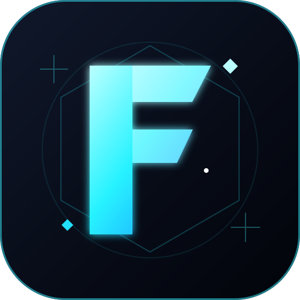

<div align="center">



# FITYORA STORE

**Digital Top Up & Online Store**


</div>

---

## Tentang FITYORA STORE

FITYORA STORE adalah platform layanan digital untuk pemesanan top-up game dan kebutuhan digital, dilengkapi katalog produk, checkout, invoice, pelacakan pesanan, dan dashboard Author.

## Fitur

- Katalog dan pengelolaan produk.
- Checkout dan pembuatan invoice.
- Pelacakan status pesanan.
- Akun pelanggan.
- Dashboard Author/Admin.
- Pengelolaan harga dan transaksi.

## Teknologi

- **Frontend:** React, Vite, TypeScript.
- **Backend:** Node.js, Express.
- **Database:** Supabase PostgreSQL.
- **Deployment:** Vercel.

## Menjalankan Proyek

```bash
npm install
cp .env.example .env     # isi DATABASE_URL, ADMIN_EMAIL, ADMIN_PASSWORD
npm run dev              # pengembangan lokal
npm test                 # tes otomatis
npm run build            # build produksi (dipakai Vercel)
```

Jangan pernah commit `.env`. Panduan deploy Vercel + Supabase lengkap: [docs/README-VERCEL-DEPLOY.md](./docs/README-VERCEL-DEPLOY.md).

## Dokumentasi

Dokumentasi teknis tersedia di folder [docs/](./docs/).

Riwayat fitur baru, perbaikan bug, dan perubahan versi dicatat dalam [PEMBARUAN.md](./PEMBARUAN.md).
